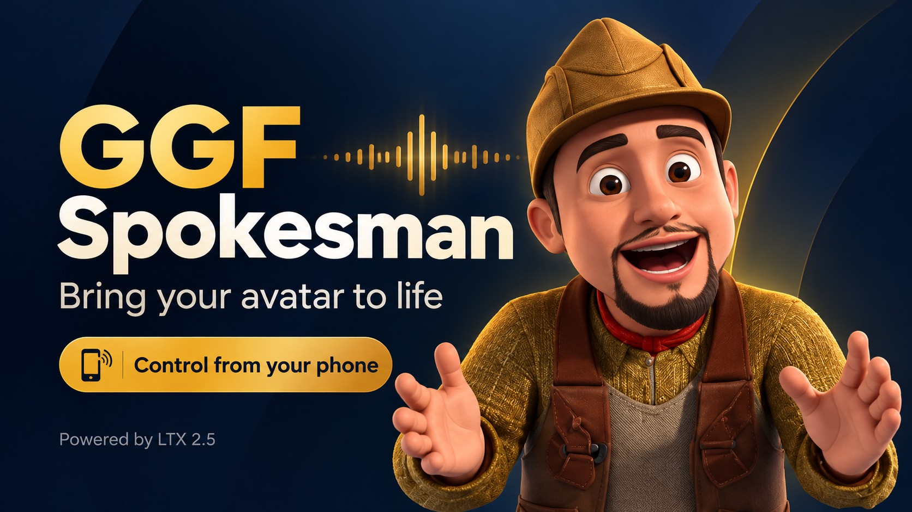

# LTX Spokesman — talking avatars powered by LTX 2.5

## A Get Going Fast Application

### [Quick Setup Helper → GetGoingFast.pro/tools/spokesman](https://getgoingfast.pro/tools/spokesman/)

The guided Windows setup is a separate Get Going Fast member download. This public repository contains the app source and manual setup instructions, not a quick installer or model weights.

Settings includes **Release models / free GPU memory** and **Stop server**.
Release unloads the worker while keeping the app and phone connection open.
The next generation reloads models automatically. Stop server asks for confirmation
and requires restarting run.bat on the local PC. Finish active generation first.

Local Gradio video generation with four simple creation modes: Lip Sync
(image + audio), Text to Video, Image to Video, and Audio to Video. The audio
mode keeps the uploaded track in the MP4; the text and image modes generate
synchronized audio with LTX 2.5. All four modes use the same five model files.
No ComfyUI installation or server is required: this app bundles only the
Python inference components it calls.

The two-stage image-to-video path follows the active part of the supplied `LTX2.5.json`: distilled INT8
model, 8-step first pass, latent 2× upscale, and 3-step detail pass. The
optional uploaded-audio path is an added feature, not present in that active
workflow branch.

## Manual installation from source

Use Windows 64-bit, a current NVIDIA driver supporting CUDA 13, [Git for Windows](https://git-scm.com/download/win), and [uv](https://docs.astral.sh/uv/getting-started/installation/). Open **Command Prompt**:

1. Clone this repository and create its private Python 3.10 environment:

   ```bat
   git clone https://codeberg.org/Cognibuild/LTX25-Core-Studio.git
   cd LTX25-Core-Studio
   uv venv --managed-python --python 3.10 .venv
   ```

2. Install CUDA PyTorch and the app requirements:

   ```bat
   uv pip install --python .venv\Scripts\python.exe torch==2.10.0+cu130 torchvision==0.25.0+cu130 torchaudio==2.10.0+cu130 --index-url https://download.pytorch.org/whl/cu130 --extra-index-url https://pypi.org/simple --index-strategy unsafe-best-match
   uv pip install --python .venv\Scripts\python.exe -r requirements.txt
   uv pip check --python .venv\Scripts\python.exe
   ```

3. Accept the [LTX 2.5 model terms](https://huggingface.co/Lightricks/LTX-2.5). If the PC is not signed into Hugging Face, run `.venv\Scripts\hf.exe auth login`. Download the five required files directly from Lightricks:

   ```bat
   .venv\Scripts\hf.exe download Lightricks/LTX-2.5 diffusion_models/ltx-2.5-22b-distilled-transformer-comfy-int8-convrot.safetensors --local-dir models
   .venv\Scripts\hf.exe download Lightricks/LTX-2.5 text_encoders/gemma4-12b-with-proj-ltx-2.5-comfy-int8-convrot.safetensors --local-dir models
   .venv\Scripts\hf.exe download Lightricks/LTX-2.5 vae/ltx-2.5-video-vae-bf16.safetensors --local-dir models
   .venv\Scripts\hf.exe download Lightricks/LTX-2.5 vae/ltx-2.5-audio-vae-bf16.safetensors --local-dir models
   .venv\Scripts\hf.exe download Lightricks/LTX-2.5 latent_upscale_models/ltx-2.5-latent-spatial-upscaler-x2-bf16-1.0.safetensors --local-dir models
   ```

4. Run `.venv\Scripts\python.exe -c "from model_config import missing_files; from pathlib import Path; assert not missing_files(Path('models'))"`, then double-click `run.bat` or run `.venv\Scripts\python.exe app.py`. The separate member installer automates these steps; its BAT file is not published in this source repository.

The model weights are **not** bundled with the app source. The installer
downloads them into `LTX25-Core-Studio\models`. Saved MP4 files and the
worker log go into `LTX25-Core-Studio\outputs`.

The Lip Sync tab preserves the original first-frame image, optional audio,
Start/End trim times, Generate button, and video output in one short flow. Its
optional motion prompt, output size, clip length, seed, and high-detail pass
appear in the Lip Sync tab's Motion and quality section. The audio preview appears only
when requested.

Text to Video needs only a scene description. Image to Video needs a starting
image and can use an optional motion description. Audio to Video needs an audio
file plus a visual description; its original audio is retained. These three
tabs default to four seconds and offer longer presets and custom durations.
Their optional quality/seed controls are collapsed by default. The full-size
detail pass is on by default; turn it off for a quicker, half-size preview.

Turning off the high-detail pass skips the latent-upscale/detail pass and
outputs at half the selected width and height. The two-stage mode outputs the
full selected size. Frames use the LTX `8*k+1` rule at 24 fps. Uploaded audio
is trimmed or padded to the selected duration. On a phone, use the Start/End
time fields below the audio upload instead of waveform handles. Times accept
seconds or `mm:ss`; the Preview button plays the selected range. The prompt
is optional: blank text lets the model infer motion from the first frame.

Fast portrait is 512 × 768, matching Fast landscape's pixel count. Each output
video appears directly below its Generate button; saved-file and timing details
are in Settings.

## Background Removal (optional)

The Background Removal tab accepts an uploaded video or a result sent from any
creation tab. Download its optional Alpha Gen adapter (about 1.3 GB) in that tab;
it reuses the installed distilled INT8 LTX model and VAEs. Accept access at
https://huggingface.co/Lightricks/LTX-2.5-22b-IC-LoRA-Alpha-Gen first. If needed,
enter a Hugging Face read token from that account; this app does not save it.
Click **Check access** after accepting the terms. The app checks permission to
the actual gated weight file without downloading it and enables Download only
after Hugging Face confirms access. A login saved on this PC can be reused by
leaving the token blank. Browser/phone login alone does not authenticate the PC
app. Fine-grained tokens must allow reading this gated model. Pending approval,
invalid tokens, and connection errors show different retry instructions.

No prompt is required. The model chooses the foreground automatically. An
optional background image replaces the background; otherwise the preview uses
a checkerboard. Downloads include a grayscale mask MP4 and optional transparent
WebM. The preview and transparent video retain source audio. Files have unique
names and save in `outputs`. Processing keeps the source shape and frame rate,
pads to the 32-pixel grid, and removes the padding from exports. Videos longer
than 145 frames are split into sections automatically; review the joins.

The same persistent worker caches both the clean base and the Alpha Gen patch.
Its previous LoRA selection is restored after matting. Release models, server
restart, or a memory failure require loading models again. Comfy can still move
weights between RAM and VRAM as needed. First/Last Frame is not included.

The 15-, 20-, 30-, 45-, and 60-second choices are experimental single-pass runs. Long clips
may run out of GPU or system memory, especially at larger sizes or with the
detail pass. A memory error releases the worker and leaves saved videos and
downloaded models untouched. Start with Fast size and no detail pass.

## Network settings

The app starts on this computer only. To make it reachable on the local network
or through a temporary public Gradio link, use the **Settings** tab. Choose an
access mode and provide a username and password of at least 12 characters.
Save, close the server, then relaunch `run.bat`; network changes do not apply
to the running process. The password is kept in `network_settings.json` as a
salted hash and is never included in the installer ZIP. Anyone with this login
can generate videos and change Settings, so do not share it broadly. Switch
back to local-only mode when network access is no longer needed.

## Performance and limits

This is a local inference experiment. On an RTX 4090, a 768×512, 49-frame,
two-stage generation completed in 37.8 seconds including initial model loading;
the repeated warm run in the same worker completed in 14.3 seconds.
The exact memory and speed depend on GPU, resolution, duration, driver, and
PyTorch build. A smaller 512×320, 17-frame two-stage run with uploaded audio
completed in 34.5 seconds. These are smoke tests, not quality or broad
compatibility guarantees; measure your own GPU and review outputs before use.
In this Studio update, 49-frame Text to Video and Audio to Video single-stage
smoke tests completed in about 29 seconds each including model loading;
full-size two-stage Text to Video completed in about 34 seconds. Those runs
verify execution, not output quality on every prompt.

## Bundled code and model licenses

`vendor/comfy_core` is a selected source snapshot from ComfyUI commit
`b0f4b7b294ce482a2e071d9d762c133d38c7aa07`, copied without frontend,
server, custom-node manager, or model weights. Its `LICENSE` is GPL-3.0.
LTX 2.5 weights remain subject to [Lightricks' separate terms](https://huggingface.co/Lightricks/LTX-2.5).
Review both sets of terms before distributing this experiment.
# Repository updates

This app follows original Headliner: Codeberg and GitHub generate the downloadable source archive directly from repository commits. Maintainers push individual files; no source ZIP or checksum manifest needs rebuilding. Settings checks repository revisions and offers Update and restart. With the server closed, run `.venv\Scripts\python.exe update_app.py`, or the outer `3-UPDATE-LTX25-Core-Studio.bat`. Models, outputs and private settings are kept; replaced source is backed up. Git is not required for customer updates.

Source: https://codeberg.org/Cognibuild/LTX25-Core-Studio and https://github.com/gjnave/LTX25-Core-Studio.
